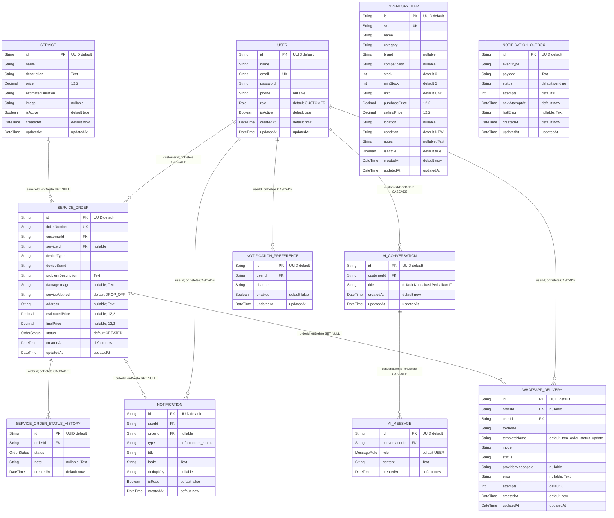

# ERD ITSM Portal (11 Entitas)

Hasil audit `prisma/schema.prisma`. Tipe dan atribut mengikuti tipe Prisma; `UK` menandai unique tunggal. Unique komposit dijelaskan sesudah diagram.

## Batasan dan unique komposit

- `Notification` memiliki `@@unique([orderId, dedupKey])`; uniqueness berlaku pada pasangan, bukan pada setiap kolom sendiri.
- `NotificationPreference` memiliki `@@unique([userId, channel])`.
- `email`, `ticketNumber`, dan `sku` unik masing-masing.
- `serviceId`, `Notification.orderId`, dan `WhatsAppDelivery.orderId` nullable. Relasi opsional memakai `SET NULL`; relasi lainnya memakai `CASCADE` seperti ditampilkan.
- `NotificationOutbox` tidak memiliki FK. `InventoryItem` tidak memiliki relasi. `AIConversation.customerId` adalah FK wajib ke `User.id`.
